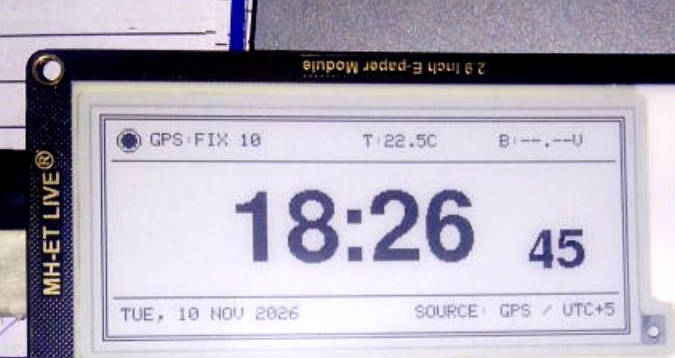
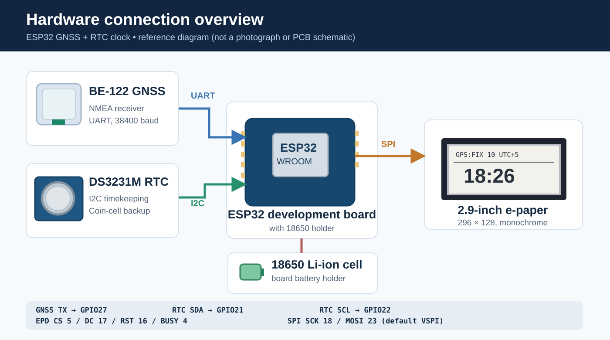

# GNSS-Synchronized E-Paper Clock

A digital clock built using an ESP32, a GNSS receiver, a DS3231M RTC, and a 2.9-inch black-and-white e-paper display. The clock reads time from GNSS when a valid fix is available and uses the RTC when GNSS is unavailable. This allows it to continue working indoors without requiring Wi-Fi or a continuous satellite connection.

The firmware is written in C++ with PlatformIO and the Arduino framework. I have kept the GNSS, RTC, timekeeping, display, and telemetry functions in separate source files so that new features can be added without mixing everything into the main loop.

## Output

The clock running on the 2.9-inch e-paper display. In this test the receiver reported a valid GNSS fix with 10 satellites. The photo is from the actual hardware setup.

<p align="center">
  
</p>

The top row shows GNSS reception, RTC chip temperature, and battery voltage status. The main area shows time in 24-hour format. The bottom row shows day, date, time source, and UTC offset. Battery measurement is not connected yet, so the voltage field shows an unavailable value.

## Hardware used

| Component | Module | Interface |
| --- | --- | --- |
| Microcontroller | ESP32-WROOM development board with 18650 holder | — |
| GNSS receiver | Beitian BE-122 | UART / NMEA |
| RTC | DS3231M with backup coin cell | I2C |
| Display | MH-ET LIVE 2.9-inch B/W e-paper, 296 × 128 | SPI |
| Battery | 18650 Li-ion cell | Board battery holder |

### Hardware connection overview

<p align="center">
  
</p>

This diagram shows the modules and the firmware pin mapping. It is an illustration for reference, not a photograph of the assembled circuit or a verified electrical schematic. The supply voltage and wiring for each module should be checked against its board specifications before reproducing the setup.

### Connections

| Signal | ESP32 pin | Notes |
| --- | --- | --- |
| GNSS TX → ESP32 RX | GPIO27 | UART2, 38400 baud |
| GNSS RX | Not connected | Receive-only application |
| RTC SDA | GPIO21 | I2C |
| RTC SCL | GPIO22 | I2C |
| E-paper CS | GPIO5 | SPI chip select |
| E-paper DC | GPIO17 | Data / command |
| E-paper RST | GPIO16 | Reset |
| E-paper BUSY | GPIO4 | Busy input |
| E-paper SCK | GPIO18 | Default ESP32 VSPI clock |
| E-paper MOSI | GPIO23 | Default ESP32 VSPI data |

The GNSS RX pin was moved to GPIO27 because the earlier GPIO19 connection conflicted with the display SPI configuration. A common ground is required between the modules. The battery voltage must not be connected directly to an ESP32 ADC input.

## What the clock does

- Reads NMEA sentences from the GNSS module and checks for valid time, date, and position data.
- Uses GNSS time to correct the RTC automatically when the GPS fix is valid.
- Synchronizes the DS3231M RTC approximately every five minutes while valid GNSS data is available.
- Falls back to the RTC when GNSS time is unavailable and uses MCU holdover if needed.
- Allows the RTC to be initialized manually through the serial monitor.
- Displays hours, minutes, seconds, day, date, source, and UTC+5 time offset.
- Shows GNSS reception status and the number of satellites reported as used in the fix.
- Shows the temperature measured by the RTC chip.
- Uses separate partial-refresh windows for the main display fields.
- Runs periodic full refreshes to reduce the ghosting caused by repeated partial updates.

## How time synchronization works

The clock follows this priority:

```text
                 GNSS fix available?
                         |
                 Yes ----+---- No
                  |             |
             GNSS time      RTC time valid?
                  |             |
                  |       Yes --+-- No
                  |        |         |
            Set clock     RTC    MCU holdover
                  |        |         |
                  +--------+---------+
                           |
                       E-paper
```

On startup, the ESP32 initializes the RTC, UART, and display. `GPS.cpp` continuously reads the incoming NMEA data. When a fresh GNSS time and valid fix are available, the local timestamp is calculated using UTC+5. The RTC time is corrected using `rtc.adjust()` and read back for verification. This correction is repeated at a five-minute interval.

If GNSS is lost, the display uses the time maintained by the DS3231M. The RTC has a coin-cell backup, so it can continue keeping time while the main ESP32 board is turned off, provided the backup battery is working.

**Manual RTC setup:** Open the serial monitor at `115200` baud and send the local time in this format:

```text
SET 2026-11-10 14:30:00
```

To check the RTC status:

```text
RTC?
```

The RTC stores local Pakistan time in the current implementation. GNSS reports UTC, which the firmware converts using the configured offset.

## Display update logic

The display is divided into independent regions for GNSS, temperature, battery, hour/minute, seconds, date, and time source. Only fields with changed values are drawn during routine updates. This reduces unnecessary e-paper activity and keeps the borders and divider lines unchanged.

The current configuration uses:

| Setting | Value |
| --- | --- |
| Seconds update | 5 seconds |
| Telemetry update | 60 seconds |
| RTC resynchronization | 5 minutes |
| Full-refresh timer | 15 minutes |
| Full-refresh partial-update limit | 60 operations |

A full refresh is performed when either full-refresh condition is reached. The independent partial windows are aligned with the display controller's byte boundaries to prevent erasing the static borders during updates.

## Code overview

The source is divided into modules. The actual working firmware folder will be uploaded after I finish the project checks.

| File | Purpose |
| --- | --- |
| `main.cpp` | Initializes hardware, runs the main loop, schedules updates, and prints diagnostics. |
| `GPS.cpp` | Receives NMEA data, checks GNSS validity, updates the RTC from GNSS. |
| `RTC.cpp` | Initializes and checks the DS3231M, handles `SET` and `RTC?`, reads chip temperature. |
| `Timekeeping.cpp` | Selects GNSS, RTC, or holdover time and returns the current local time. |
| `Display.cpp` | Draws the clock, borders, fonts, indicators, and partial/full update regions. |
| `Telemetry.cpp` | Reads RTC temperature and optional battery voltage. |
| `ClockState.cpp` | Defines shared hardware objects and clock state. |
| `ClockConfig.h` | Contains GPIO assignments, timezone, and refresh settings. |

### Main functions

| Function | What it does |
| --- | --- |
| `feedGpsParser()` | Reads GNSS UART bytes and passes them to TinyGPSPlus. |
| `syncRtcFromGps()` | Checks fresh GNSS date/time/fix and synchronizes the RTC. |
| `getCurrentLocalTime()` | Selects the available time source. |
| `handleSerialCommands()` | Handles manual time setting and RTC status commands. |
| `refreshTelemetry()` | Updates temperature and battery readings. |
| `fullDisplayUpdate()` | Redraws the complete screen and static layout. |
| `updateClockDisplay()` | Updates only the display regions that have changed. |

### Project structure

```text
.
├── include/
│   ├── ClockConfig.h
│   ├── ClockState.h
│   ├── ClockTypes.h
│   ├── GPS.h
│   ├── RTC.h
│   ├── Timekeeping.h
│   ├── Display.h
│   └── Telemetry.h
├── src/
│   ├── main.cpp
│   ├── ClockState.cpp
│   ├── GPS.cpp
│   ├── RTC.cpp
│   ├── Timekeeping.cpp
│   ├── Display.cpp
│   └── Telemetry.cpp
├── images/
│   ├── clock-output.jpg
│   └── hardware-overview.svg
├── platformio.ini
└── README.md
```

The source code and PlatformIO project are not included in this first documentation release. They will be added to the repository after the final review.

## Build environment

The project is developed using **VS Code**, **PlatformIO**, and the **Arduino framework** for `esp32dev`.

Main libraries:

- [TinyGPSPlus](https://github.com/mikalhart/TinyGPSPlus) for GNSS/NMEA parsing.
- [RTClib](https://github.com/adafruit/RTClib) for DS3231M timekeeping.
- [GxEPD2](https://github.com/ZinggJM/GxEPD2) for e-paper display updates.
- [Adafruit GFX](https://github.com/adafruit/Adafruit-GFX-Library) for graphics and fonts.

When the source is available, open the project in PlatformIO, install the declared libraries, build for `esp32dev`, and upload to the board. The project also uses two custom font headers, `FreeSansBold28pt7b.h` and `FreeSansBold16pt7b.h`, which need to be included with the final firmware release.

## Testing and current status

The ESP32, display, DS3231M RTC, serial time-setting command, and GNSS NMEA communication have been tested on the physical setup. The output photo shows the receiver reporting a valid GNSS fix with 10 satellites and the clock displaying the GNSS source. The firmware includes RTC synchronization and fallback logic; long-term RTC drift, battery runtime, and extended e-paper ghosting tests are still pending.

The battery voltage feature is currently disabled because the ADC voltage-divider hardware has not yet been connected and verified. The temperature is read from the RTC chip and should not be treated as a calibrated ambient temperature measurement.

## Possible improvements

- Add and calibrate the battery-voltage sensing circuit.
- Measure current consumption and improve battery runtime.
- Test RTC drift over longer periods without GNSS.
- Add configurable 12-hour / 24-hour display settings.
- Complete enclosure design and extended e-paper refresh testing.

## Author

**Muhammad Huzaifa Zahid** — [GitHub](https://github.com/huzaifazahid888) | [Portfolio](https://huzaifazahid888.github.io/)